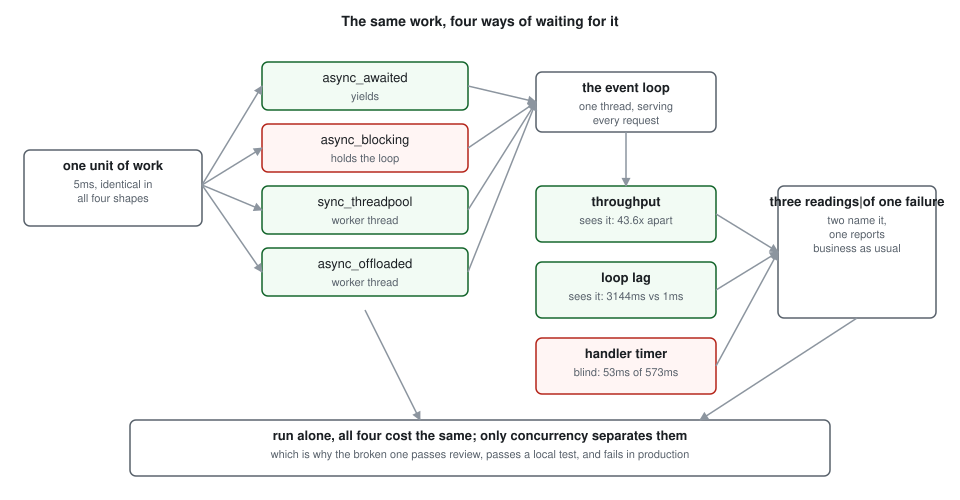
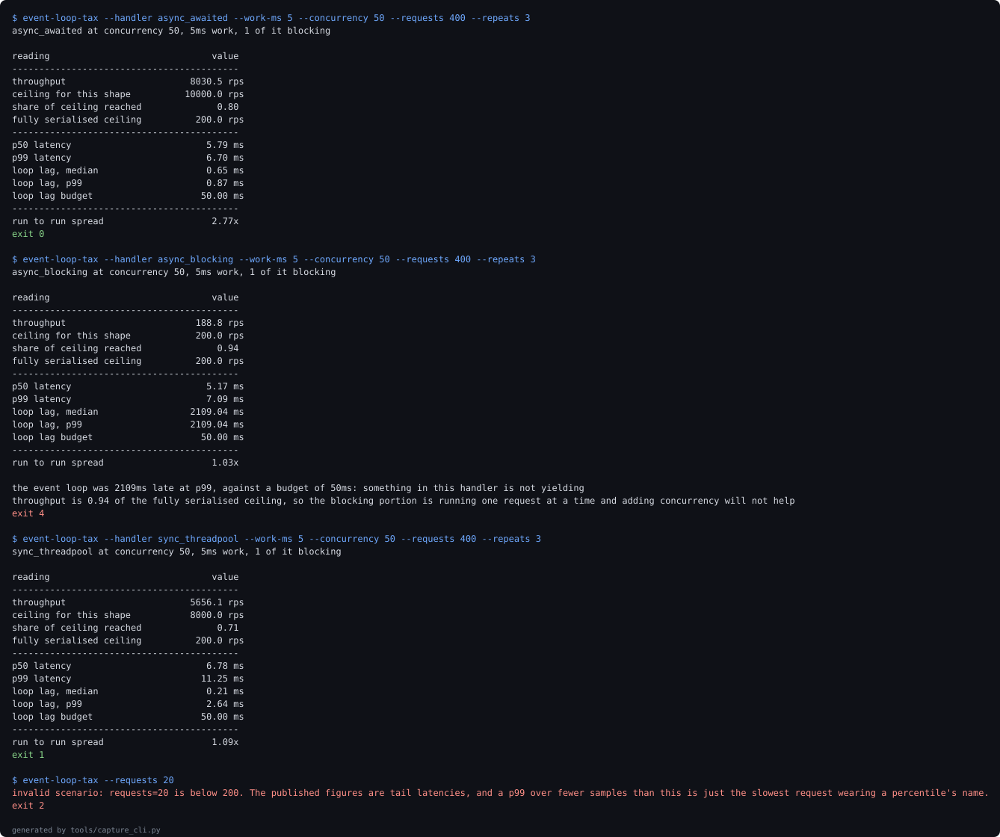

# event-loop-tax

`async def` is not a performance decision. What you call inside it is.

One synchronous call in an async handler costs more than the entire async architecture
buys, and it is invisible in code review, invisible in a profiler at low load, and
invisible to the latency metric most services already have.

Four handler shapes, the same work, measured in process and then against a real uvicorn.



## The four shapes

Run alone, all four take the same wall time. That is why this bug ships. Under 50
concurrent requests, each doing 5ms of work:

| handler | rps | ceiling | p99 ms | loop lag p99 ms |
| --- | --- | --- | --- | --- |
| async_awaited | 8296.7 | 10000.0 | 5.95 | 1.10 |
| async_blocking | 190.20 | 200.00 | 5.93 | 3144.3 |
| sync_threadpool | 6627.7 | 8000.0 | 9.83 | 1.88 |
| async_offloaded | 6548.2 | 8000.0 | 9.97 | 1.21 |

The correct coroutine does 43.6 times the throughput of the blocking one. A plain `def`
handler, dispatched by the framework to a worker thread, does 34.8 times what a coroutine
that blocks manages. The shape people are warned away from is the safe one; the shape they
reach for is the dangerous one if its body is wrong.

## The reading that should have caught it did not

Look again at the p99 column. The broken handler has a p99 of 5.93ms. All 3 of the healthy
shapes are worse.

That is not a mistake in the measurement, it is the measurement. A closed loop client
stops sending while the loop is held, so the requests that would have arrived during the
stall are never issued and never counted as slow. Latency percentiles are computed over
the requests that got through, and the ones that got through were fine.

The reading that separates them is event loop lag: how late the loop is to run a task that
asked to run. The blocking handler leaves it 3144ms late at p99, against 1.10ms for the
correct coroutine. It is the metric almost nobody exports and the only one here that names
the problem rather than describing a symptom.

## Adding concurrency cannot help, and that is arithmetic

A coroutine that holds the loop runs its blocking portion one request at a time. The
ceiling is one divided by the blocking time, and concurrency does not appear in that
expression. So throughput times blocking seconds should equal one at every load.

| concurrency | async_awaited rps | async_blocking rps | rps x blocking_s |
| --- | --- | --- | --- |
| 1 | 187.0 | 186.2 | 0.9308 |
| 5 | 904.1 | 190.3 | 0.9515 |
| 10 | 1812.7 | 190.4 | 0.9518 |
| 25 | 4374.3 | 188.7 | 0.9434 |
| 50 | 8204.8 | 191.2 | 0.9559 |
| 100 | 14949.0 | 189.2 | 0.9462 |
| 200 | 28463.8 | 191.4 | 0.9571 |

Across a 200-fold range of concurrency the product stays between 0.9308 and 0.9571, a
factor of 1.028. The sweep is never told what that product should be, so the agreement is
evidence the ceiling is real rather than a coincidence of one setting. It sits just under
one because the loop and the harness cost something per request; it can never legitimately
exceed one, and `tools/check_invariant.py` fails the build if any recorded figure does.

Over the same range the correct coroutine grows 152-fold. The blocking one grows 1.03-fold,
which is to say it does not.

## There is no safe amount

Nobody writes a fully blocking handler. They write one that awaits a database, awaits a
cache, and then does one small synchronous thing: parses a token, hashes a password,
serialises with a C library that holds the GIL.

So the question is how much is too much. This experiment went looking for a knee and did
not find one. Loss begins at the smallest fraction measured and grows from there.

| blocking fraction | retained at 50 | retained at 200 |
| --- | --- | --- |
| 0 | 100.0 | 100.0 |
| 0.005 | 88.7 | 30.2 |
| 0.01 | 72.4 | 24.4 |
| 0.02 | 56.1 | 18.1 |
| 0.05 | 27.0 | 8.7 |
| 0.1 | 17.1 | 5.3 |
| 0.25 | 8.2 | 2.5 |
| 0.5 | 4.4 | 1.4 |
| 1 | 2.3 | 0.7 |

0.025ms of blocking out of 5ms costs 11.3 percent of throughput at 50 concurrent requests
and 69.8 percent at 200. The handler is byte-identical in both columns. Only the traffic
changed, and the same line of code went from a rounding error to losing most of the
service's capacity.

Meanwhile, at fractions of one percent and below, loop lag p99 stays at 3.52ms. Nothing
looks wrong anywhere.

## Would your instrumentation catch it?

The experiments above run in process against a model of a handler. This one runs a real
uvicorn over real sockets with FastAPI's own routing, and times the identical requests
from three places: inside the handler body, in an HTTP middleware that wraps the
application, and at the client.

| shape | rps | handler p99 | middleware p99 | client p99 |
| --- | --- | --- | --- | --- |
| async_awaited | 177.20 | 52.29 | 55.00 | 62.78 |
| sync_threadpool | 177.50 | 52.87 | 60.68 | 72.91 |
| async_offloaded | 175.40 | 55.22 | 57.80 | 67.67 |
| async_blocking | 19.40 | 53.24 | 475.63 | 572.74 |

The handler clock reads 53.24ms on requests the client waited 572.74ms for, a factor of
10.8. On the correct coroutine the same clock is accurate to 1.20.

That clock is not broken and it is not lying. It starts when the loop hands the request to
the handler, so it cannot observe the request waiting to be handed over, and waiting to be
handed over is the entire failure. The middleware clock reads 475.63ms because it wraps
the application across the task boundary. Where the timer goes decides whether the bug is
visible, and both placements look equally reasonable in a code review.

Throughput tells the truth from anywhere: a factor of 9.1 on a real HTTP stack.

Every figure in this section was taken well under the apparatus ceiling of 726 rps, the
throughput of a route that does no work at all, against a predicted 200 rps for the
handlers themselves. An earlier version of this experiment ran
at a concurrency where every shape including the healthy ones collapsed to the same
number, which was the HTTP stack and the load generator competing for two cores rather
than anything about the handlers.

## Using it

```bash
pip install -e ".[dev]"

event-loop-tax --handler async_blocking --work-ms 5 --concurrency 50
make verify      # lint, suite, the invariant check, the figure check
make bench       # rerun the four experiments and rewrite docs/experiments
```

| code | meaning |
| --- | --- |
| 0 | throughput near its ceiling and the loop is responsive |
| 1 | throughput materially below the ceiling for this shape |
| 2 | scenario rejected before anything was measured |
| 3 | the measurement failed to complete |
| 4 | the event loop is being held by something that will not yield |
| 5 | measured faster than the model allows, so the result is refused |



That image is generated from stdout captured at run time, and
`docs/evidence-manifest.json` records each command with the exit code it actually
returned. It is not byte reproducible, because it contains real timings; the exit codes
are, and they are what the manifest exists to let you check.

Exit 4 is the one worth having. It does not say the service is slow, which a latency graph
already says. It says why. Exit 5 is the one that protects the rest: a measurement above
the ceiling means the model or the harness is wrong, so the tool refuses to print a number
rather than publishing one nobody should trust.

## Verification

Two kinds of figure, checked two ways. The suite is deterministic and re-measured on every
run. The timings are not, so they are read from the recorded run in `docs/experiments` and
regenerated deliberately by `make bench`, because a check that re-measures a noisy quantity
and demands it match fails at random, and a check that fails at random is one everybody
learns to ignore.

What is re-derived on every verify is the relationship between them.
`tools/check_invariant.py` recomputes every ceiling from `theory.py` and fails if any
recorded throughput exceeds what its shape allows, if the serialised invariant leaves its
band, or if the live experiment ran at or above the apparatus ceiling. Those hold on any
machine. Tripling one recorded figure makes it exit 1, which is how it was checked.

Both kinds are registered in `docs/metrics.json` with anchor phrases and checked in both
directions: every metric must appear in the prose through its anchor, and every decimal in
the prose must correspond to a metric. The suite is 90 tests at 100 percent line coverage.

## What this cannot measure

One process on two cores, with `time.sleep` standing in for a synchronous network call.
[ADR-005](docs/adr/ADR-005-what-this-cannot-measure.md) is the full list: no multi-worker
deployment, no CPU-bound blocking, a closed loop client whose bias flatters the blocking
handler, and a generated workload rather than a real one.

## How this was built

I built this with AI assistance (Claude), working through the design, the experiments and
the writing in dialogue. The judgements are recorded in `docs/adr/` as they happened,
including two corrections I attempted and rejected because they produced figures that
contradicted the data. I am stating this plainly because a portfolio repository is a claim
about its author, and a reader deserves to know which parts of the claim are about writing
the code and which are about the engineering judgment in it.

## Layout

```
src/event_loop_tax/   config, workload, lag, theory, harness, server, live, report, cli
experiments/          the four experiments, writing JSON to docs/experiments/
tests/                90 tests
tools/                metric collection, the invariant check, the number checker
docs/adr/             five decision records
```
